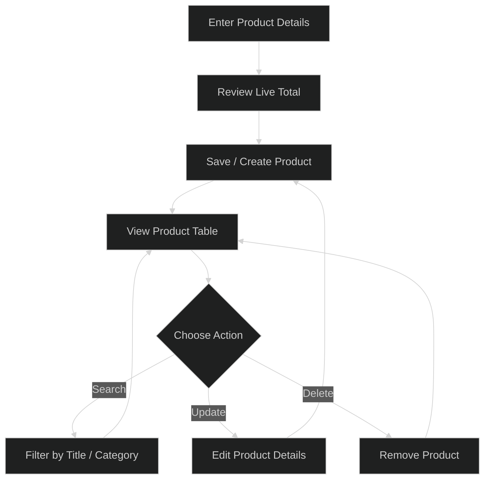

# CRUDS

### A simple, practical product management system

Create, organize, search, and update product records from a clean browser-based dashboard.
<br>  


## Overview


**CRUDS** is a lightweight product management app built with vanilla HTML, CSS, and JavaScript. It brings the essential product-record workflows together in one place: create products, calculate their total cost, find them with search, edit their details, and remove records when they are no longer needed.

The app runs directly in your browser and saves its product list to **Local Storage**. There is no backend, account, database setup, or build process.

## What You Can Do

| Capability | Description |
| --- | --- |
| **Create products** | Record a product's title, price, optional charges, discount, and category. |
| **Calculate totals** | See the total update as you enter the price components. |
| **Create multiple records** | Use the Count field to add several copies of the same product at once. |
| **Update products** | Load an existing product into the form, make changes, and save it. |
| **Delete products** | Remove one product or clear the complete product list. |
| **Search the list** | Filter products by title or category as you type. |
| **Keep data between visits** | Product records remain in the same browser after a page refresh. |

## Total Calculation

The total is calculated using:

```text

Total = Price + Taxes + Ads - Discount

```

Taxes, advertising costs, and discount are optional; empty values are treated as zero. A title and price are required to create a product.

## Typical Workflow



## Using the App

### Add a product

1. Enter a **Title** and **Price**.

2. Optionally enter **Taxes**, **Ads**, and **Discount**. The total display updates while you type.

3. Set **Count** if you want to create multiple copies of the same product.

4. Enter a **Category** if needed, then select **Create**.

### Find a product

1. Select **Search By Title** or **Search By Category**.

2. Type part or all of the value into the search box.

3. The table filters as you type. Search ignores letter case.

### Edit or remove products

- Select **Update** in a product row to load its values into the form. Make your changes and select **Update** to save them.

- Select **Delete** in a row to remove that product.

- Select **Delete All** above the table to remove every product.

## Data and Privacy

Product data is stored in the browser's `localStorage` under the `products` key. It is not uploaded to a server by this app.

>  **Important:** Local Storage belongs to the current browser and device. Products are not automatically synchronized with other browsers or devices, and clearing browser site data removes the saved list.

## Getting Started

There are no dependencies to install and no build commands to run.

1. Download or clone this project.

2. Open `index.html` in a modern web browser.

3. Start adding products.

## Project Structure

```text

CRUD JS/

├── index.html # App structure, form, search controls, and product table

├── CSS/

│ └── style.css # Dark theme, layout, and interactive styling

└── JS/

└── script.js # Product operations, total calculation, search, and storage

```

## Built With


-  **HTML5** for the page structure

-  **CSS3** for layout, theme, and visual styling

-  **Vanilla JavaScript** for product management and interactions

-  **Browser Local Storage** for client-side persistence
---

<div  align="center">  
Made as a focused practice project for building a CRUD interface with core web technologies.
</div>